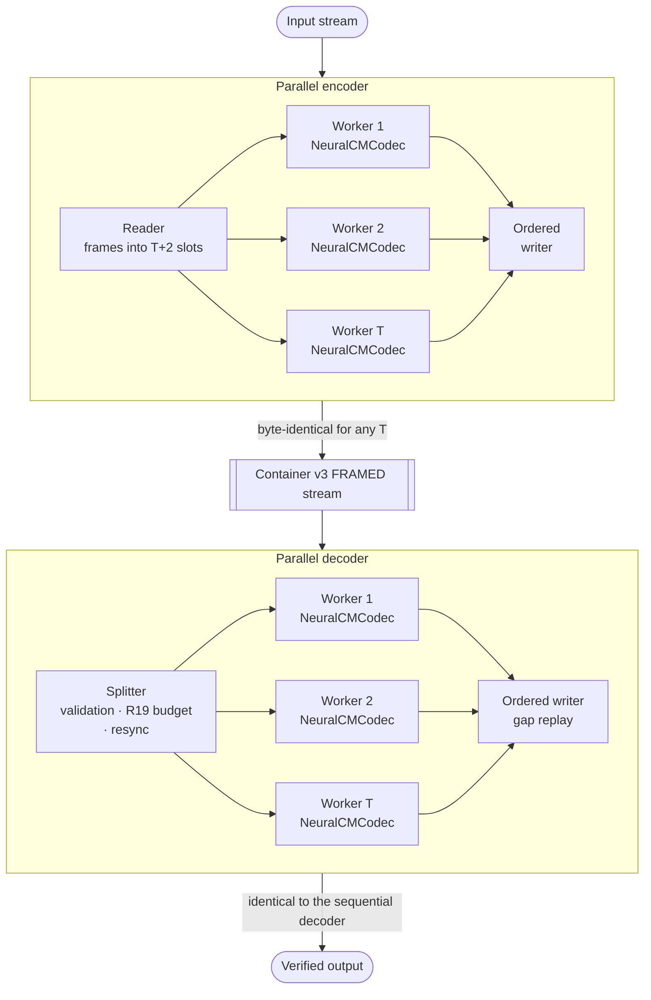
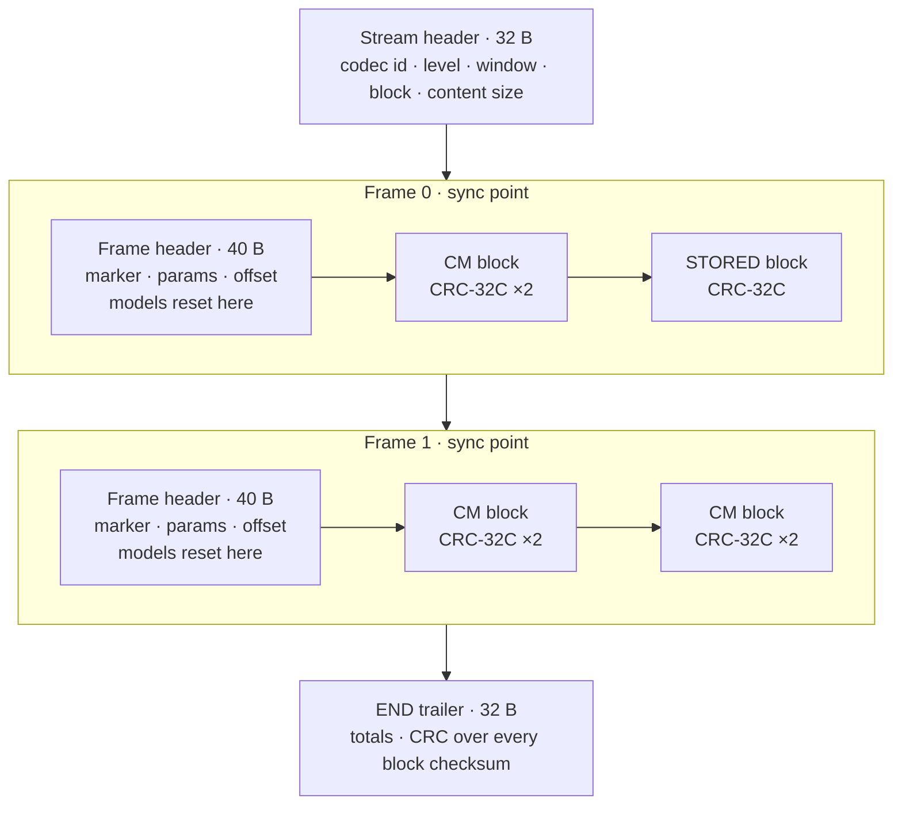
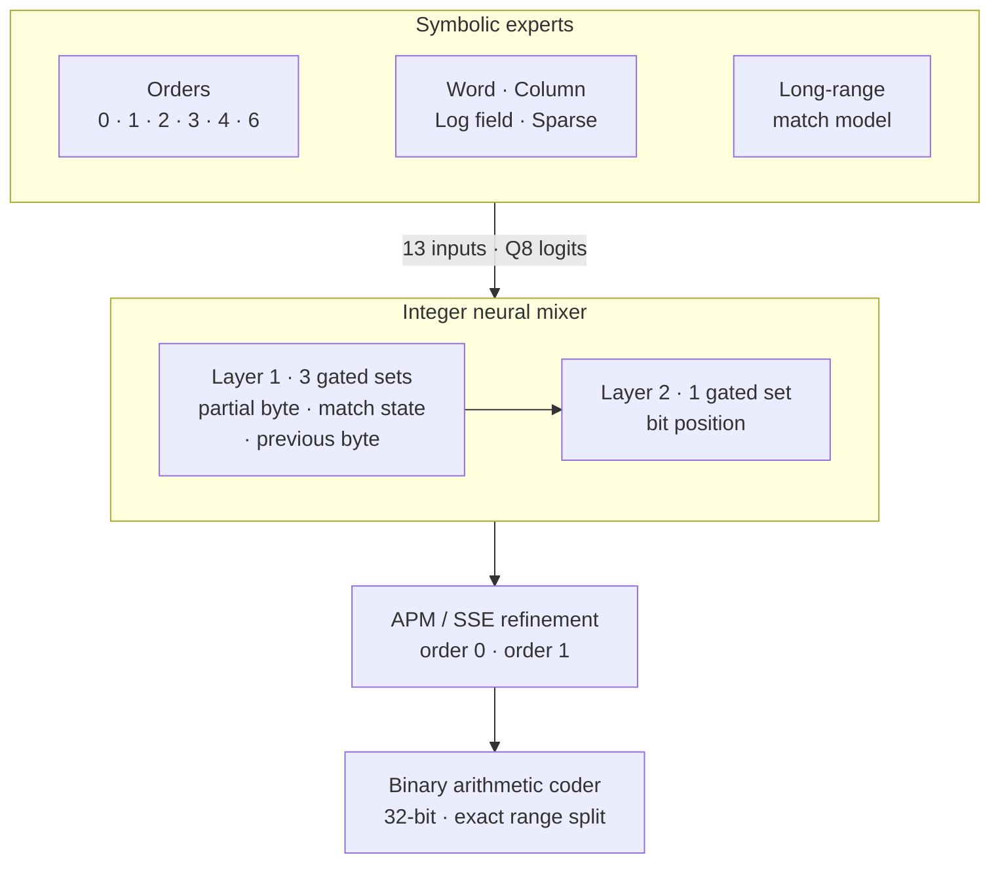

<div align="center">

# HCE — Hybrid Compression Engine

**Neural-symbolic context mixing in a hardened, streaming, parallel container.**

21–45% smaller than `zstd -19` on text, source code and logs · bit-exact on x86-64 and AArch64 ·
zero sanitizer findings across GCC and Clang

[](https://github.com/Aung-Nyi-Thant/neural-symbolic-code/actions/workflows/ci.yml)
[](#quick-start)
[](LICENSE)
[](#quality-assurance)
[](#determinism-r11r17)
[](#performance-and-benchmarks)
[](#quick-start)

[Overview](#overview) · [Architecture](#architecture) · [Hardening](#hardening-and-security-r11r21) ·
[Quality](#quality-assurance) · [Benchmarks](#performance-and-benchmarks) · [Quick start](#quick-start) ·
[Tooling](#tooling-and-automation) · [License](#license)

</div>

---

## Overview

HCE is a C++20 compression engine built for data that must be **small, verifiable and safe to decode**:
log archives, backups, data-lake cold tiers and bandwidth-bound transfers. It pairs a real
**neural-symbolic context-mixing (CM) codec** with **Container v3 FRAMED**, a streaming format engineered
for hostile input, partial damage and parallelism.

| Pillar | What it means |
|---|---|
| **Ratio** | Across levels 0–4, 21–45% smaller than `zstd -19` and 19–41% smaller than `xz -9e` on the benchmark corpus, with the largest gains on logs. |
| **Safety** | Memory, output volume and decode work are bounded by declared, validated limits. Nothing is emitted before it is verified. |
| **Resilience** | Every frame is an independent sync point. Damage costs only the frames it touches; three recovery modes report every lost byte range. |
| **Reproducibility** | The output is byte-identical across thread counts, SIMD kernel paths (scalar, SSE2, AVX2, NEON), compilers (GCC, Clang) and architectures (x86-64, AArch64). |
| **Parallelism** | Frames compress and decompress on all cores under counting-semaphore back-pressure and a hard memory bound. |

> [!NOTE]
> **Status:** version 2.1.0. Container v3 FRAMED, codec profile 1 (`prior_id` `0x4E434D01`).
> Streams from 1.x, written by the retired LZ stand-in codec, are rejected as unsupported (exit 5),
> never misdecoded.

---

## Architecture



### Tiered v3 container: stream → frame → block



- **Stream** — a self-describing header carries the codec ID, level, window and block geometry, and the
  content size. The size may be recorded as unknown, so pipes are supported (R18). Concatenated streams
  decode back to back.
- **Frame** — a sync point. An 8-byte marker and a CRC-protected 40-byte header repeat every coding
  parameter plus the frame's output offset. Models reset completely at every frame, so each frame decodes
  on its own: this is what enables parallel decoding, late join and recovery.
- **Block** — up to 8 MiB. A 20-byte header carries the sizes and CRC-32C checksums of both the payload
  and the decoded content. Blocks are `CM` (always strictly smaller than their content), `STORED`, or
  skippable `ancillary` metadata.

### Neural-symbolic CM codec



The codec predicts every bit and codes it with a binary arithmetic coder.

- **Symbolic experts.** Ten counter-based context models make the predictions. Orders 0 and 1 use direct
  tables; orders 2, 3, 4 and 6 are hashed. The remaining four are domain contexts: a case-folded **word**
  model, a **column** model that predicts from the byte above in the previous line, a **log-field** model
  keyed by the separator count of the current line and the last two bytes, and a **sparse** model that
  skips the most recent byte. Every context state is a 16-bit counter (12-bit probability, 4-bit
  confidence). The hashed models keep theirs in nibble-bucketed, two-way associative tables with
  deterministic replacement.
- **Match model.** A long-range match model indexes 6-byte contexts. It verifies every candidate inside
  the window before predicting from it.
- **Neural mixer.** A two-layer integer mixer combines the experts' logits. In layer 1, symbolic state
  (the partial byte, the match state and the previous byte) selects three of 544 weight sets; layer 2
  selects one of eight by bit position. Weights are int16 in Q14 format and learn online by integer gradient steps.
- **Refinement and coding.** Two adaptive probability maps (APM/SSE) refine the mixer's output. The
  arithmetic coder splits its range exactly with a 64-bit product, and the decoder rejects any payload it
  does not consume exactly.

**Neuro-symbolic routing.** Deterministic symbolic signals route every decision in the system:

- **Blocks.** An integer entropy-and-repeat estimator routes each block to CM or STORED. A block that
  would expand is stored instead, and the encoder rebuilds the exact decoder state by replay (R12).
- **Bits.** Symbolic context gates which weight sets the neural mixer uses for every bit.
- **Bytes.** Inside long verified matches, coding switches to a single decision per byte. Both sides take
  this switch from state they share (R13).

**Levels** trade model memory for ratio. The decoder needs the same model memory, plus the window and one block buffer.

| Level | Model memory per thread | Buckets per expert | Match-table entries | One-decision path from |
|:---:|---:|---:|---:|---:|
| 0 | 21 MiB | 2¹⁶ | 2¹⁸ | 32-byte matches |
| 1 | 38 MiB | 2¹⁷ | 2¹⁹ | 64-byte matches |
| **2** (default) | **40 MiB** | 2¹⁷ | 2²⁰ | 128-byte matches |
| 3 | 76 MiB | 2¹⁸ | 2²¹ | 256-byte matches |
| 4 | 149 MiB | 2¹⁹ | 2²² | 1,024-byte matches |

---

## Hardening and security (R11–R21)

HCE is specified by eleven hardening rules. Each is enforced in code and exercised by the test suites.

### Determinism (R11–R17)

| Rule | Guarantee | How it is enforced |
|:---:|---|---|
| **R11** | No model state is shared between threads | Each worker owns a codec. Output is byte-identical for 1, 2, 3, 5 and 8 threads (tested). |
| **R12** | STORED data feeds the history but never the models | When a block would expand, it is stored and the encoder replays the frame's CM blocks to restore the decoder's exact state. Replay is capped at 3 per frame. |
| **R13** | Implicit decisions use shared integer state only | The match fast path, weight-set gating and block-start context derivation all read decoded state, never encoder-only data. |
| **R14** | Declared widths, no overflow | Formats are fixed-point: Q8 logits, Q12/Q16/Q22 probabilities, Q14 weights. Key bounds are checked by `static_assert`, and the tables are generated by `consteval` integer code. |
| **R15** | SIMD is exact | Dot products are int16×int16→int32 sums kept below 2³⁰, so every reduction order agrees. Training is lane-wise and identical on SSE2, AVX2 and NEON. |
| **R16** | No floating point on the decode path | The codec contains no floating point at all. |
| **R17** | Format changes need a new version | Nine golden streams freeze profile 1. Changing any coded bit requires a new codec ID. |

### Streaming I/O (R18)

- **Pipe-native.** The decoder is a push API that never seeks and never reads past what it consumes. The
  encoder emits frames as they complete. Both ends work on pipes, and the content size is recorded when
  it is known.
- **Atomic files.** The CLI writes to a temporary file in the target directory, then fsyncs and renames
  it. A failed or interrupted run leaves no partial file unless `--keep-partial` is given.
- **Clean shutdown.** SIGINT, SIGTERM and SIGHUP stop a run promptly and remove temporary files. A closed
  pipe surfaces as an error (exit 1), never as a hang.

### Bounded resources and compression-bomb defense (R19)

- **Token-bucket expansion budget.** Output may not exceed `ratio × input + burst`. Each input byte earns
  `ratio` bytes of credit, up to the burst, and each block spends its declared size **before** any decode
  work. The `untrusted` profile sets a ratio of 100 with a 64 MiB burst. In the tests, a 6 MiB bomb stops
  at the configured burst with identical results from the sequential and parallel decoders.
- **Declared limits, checked before allocation.** Memory, window, block size, level and total output are
  validated against the stream header before anything is allocated, and each stream allocates at most once.
  The `untrusted` profile caps these at 256 MiB, 32 MiB, 1 MiB, level 3 and 64 GiB respectively.
- **Shape checks.** A CM block must be strictly smaller than its content, and a STORED block exactly the
  size of its content. Anything else is rejected as corrupt before decoding.
- **Bounded work per byte.** CM decoding costs O(declared size) whatever the payload. A frame reset clears
  only the cache lines the previous frame touched, so a stream of tiny frames cannot amplify CPU time: at
  level 4, 390 one-KiB frames decode within about 10% of the time one frame holding the same bytes takes.

### Recovery and integrity (R20)

- **Verify, then emit.** Every block's payload and decoded content are checked with CRC-32C before a single
  byte reaches the output. The END trailer cross-checks totals and the full list of block checksums.
- **Three recovery modes.**
  - `strict` stops at the first damage; its output is always a verified prefix.
  - `skip` drops lost ranges.
  - `skip_and_fill` preserves offsets by filling lost ranges with a chosen byte.

  Every lost range is reported as JSON with its output offset, length, input offset and cause.
- **Resynchronization.** After damage, the decoder scans for the next frame marker, and forged markers fail
  their CRC. STORED blocks inside a damaged frame are salvaged. In the recovery modes, decoding can join a
  stream mid-way at any frame header.
- **Deterministic recovery.** For every damaged input, the parallel decoder produces exactly the sequential
  decoder's output, status, gap reports and statistics, which is checked by differential fuzzing. The full
  suite, recovery included, passes on x86-64 and AArch64.

### Bounded history (R21)

- **Ring window.** The history is a ring of `2^window_log` bytes (64 KiB to 1 GiB). Memory does not depend on
  input size, and a sync point costs O(1).
- **Validated references.** Every back-reference and match candidate is range-checked against the reachable
  window. Table positions are 32-bit and validated by distance, so aliasing is deterministic, never undefined.
- **Exact arena.** All codec tables are carved from one caller-provided arena. `memory_required()` is exact:
  binding into one byte less fails.

---

## Quality assurance

Every configuration builds with `-Wall -Wextra -Wpedantic -Wshadow -Wconversion -Wsign-conversion -Werror`,
and every suite it builds passes with **zero compiler warnings and zero sanitizer reports**.
[CI](.github/workflows/ci.yml) runs the whole matrix on every push and pull request; each row is a CMake
preset, so any of them reproduces locally (see [Tooling and automation](#tooling-and-automation)).

| Preset | Toolchain | Instrumentation | Suites |
|---|---|---|:---:|
| `release` | GCC 13 `-O3` | — | 6 |
| `clang-release` | Clang 18 `-O3` | — | 6 |
| `gcc-asan` | GCC 13 | ASan + UBSan | 6 |
| `clang-asan` | Clang 18 | ASan + UBSan | 6 |
| `gcc-tsan` | GCC 13 | TSan | 6 |
| `clang-tsan` | Clang 18 | TSan | 6 |
| `aarch64-qemu` | GCC 13 cross, `armv8.2-a+dotprod` | QEMU user mode, `-cpu max` | 6 |
| `mingw-wine` | MinGW-w64 GCC 13 cross, static | Wine 9 | 5 (the CLI is POSIX-only) |

| Suite | Scope | Highlights |
|---|---|---|
| `framing` | Container (R18–R21) | 3,000-iteration mutation fuzz (bit flips, insertions, deletions, truncation), checked in strict and fill modes. Also: resync, forged markers, bombs, late join, cancellation. |
| `codec` | CM codec | 200,000-case SIMD parity per path. Nine golden streams. 120 CRC-valid hostile payloads, decoded in two modes. Also: replay, late join, window bound and reset-cost bound. |
| `pipeline` | Parallel encoder and decoder | Byte-identical output for 1, 2, 3, 5 and 8 threads. Differential fuzzing on damaged streams (pipeline ≡ sequential). Also: cancellation, I/O failure, and a race-regression test (60 repetitions). |
| `aio` | Asynchronous file I/O | Every backend present (io_uring, worker threads): the engine contract, round trips across sizes, queue depths and `O_DIRECT`, interrupts and errors, and the pipelines over async files. |
| `structural` | Structural codec | Tokenizer fuzzing for losslessness, hostile token and model images, deterministic models, round trips across thread counts and SIMD paths, archives on every aio backend, damaged archives. |
| `cli` | `hce` binary | Exit codes, atomic output files, pipes, SIGINT and EPIPE, gap reports, limits, legacy-stream rejection, structural mode and format detection. |

**Cross-architecture bit-exactness.** The same nine golden streams, compared by size and CRC-32C, are
reproduced on x86-64 with the scalar, SSE2 and AVX2 kernels and on AArch64 with NEON, from GCC and Clang
builds. Streams written on either architecture decode on the other.

> [!TIP]
> Force a kernel path with `HCE_SIMD=scalar|sse2|avx2|neon`; every path writes identical streams.
> Deepen the differential fuzz with `HCE_FUZZ_ITERS=2000 ./build/release/test_pipeline`.

---

## Performance and benchmarks

**Setup.** Intel Xeon @ 2.80 GHz (4 vCPU cloud VM), Linux 6.18, GCC 13.3 `release` build. Each figure is
the best of two runs; tools ran single-threaded unless noted; MB = 10⁶ bytes. Baselines: gzip 1.12,
zstd 1.5.5, xz 5.4.5.

**Corpus.**

| Name | Contents | Size |
|---|---|---:|
| Prose | Package changelogs (English prose) | 4,000,000 B |
| Source code | Python 3.12 standard library | 4,000,000 B |
| System logs | Real `dpkg`/`apt` logs | 1,019,495 B |
| Access logs | Synthetic HTTP access log | 4,000,000 B |

### Compressed size (bytes, lower is better)

| Corpus | gzip -9 | zstd -19 | xz -9e | hce -l0 | **hce -l2** | hce -l4 |
|---|---:|---:|---:|---:|---:|---:|
| Prose | 890,674 | 357,486 | 343,944 | 257,074 | **251,185** | 250,180 |
| Source code | 975,333 | 777,950 | 761,780 | 615,559 | **602,376** | 597,364 |
| System logs | 107,531 | 77,263 | 72,752 | 52,572 | **42,761** | 42,653 |
| Access logs | 500,361 | 376,366 | 359,816 | 240,832 | **231,025** | 230,738 |

### Size reduction vs `zstd -19`

| Corpus | hce -l0 | **hce -l2** | hce -l4 | Ratio, hce -l2 vs zstd -19 |
|---|---:|---:|---:|---:|
| Prose | 28.1% | **29.7%** | 30.0% | 15.9 : 1 vs 11.2 : 1 |
| Source code | 20.9% | **22.6%** | 23.2% | 6.6 : 1 vs 5.1 : 1 |
| System logs | 32.0% | **44.7%** | 44.8% | 23.8 : 1 vs 13.2 : 1 |
| Access logs | 36.0% | **38.6%** | 38.7% | 17.3 : 1 vs 10.6 : 1 |

### Throughput (MB/s, one thread, compress / decompress)

| Tool | Prose | Source code | System logs | Access logs |
|---|---:|---:|---:|---:|
| gzip -9 | 18.8 / 149 | 5.6 / 133 | 19.5 / 111 | 12.9 / 175 |
| zstd -19 | 3.6 / 249 | 1.1 / 223 | 1.6 / 123 | 1.1 / 250 |
| xz -9e | 2.0 / 111 | 1.2 / 62 | 2.0 / 81 | 0.7 / 89 |
| hce -l0 | 1.5 / 1.4 | 0.69 / 0.67 | 0.86 / 1.1 | 0.94 / 1.0 |
| hce -l2 | 1.2 / 1.3 | 0.65 / 0.63 | 0.72 / 0.84 | 0.83 / 0.80 |
| hce -l4 | 0.86 / 1.0 | 0.52 / 0.51 | 0.68 / 0.65 | 0.73 / 0.62 |

### Multi-threaded scaling

The input is 32 MiB of access logs, which forms four 8 MiB frames, at level 2. The output is
**1,932,155 bytes (17.4 : 1), byte-identical at every thread count**; `zstd -19` produces 3,154,033 bytes.

| Compression | Throughput | Speed-up |
|---|---:|:---:|
| `-T 1` | 0.78 MB/s | 1.0× |
| `-T 2` | 1.66 MB/s | 2.1× |
| `-T 4` | 3.00 MB/s | **3.9×** |

| Decompression | Workers | Throughput | Speed-up |
|---|:---:|---:|:---:|
| `-T 1` | sequential | 0.78 MB/s | 1.0× |
| `-T 4`, default `trusted` limits | 3 | 1.54 MB/s | 2.0× |
| `-T 4 --max-window 8M --max-level 2` | 4 | 3.05 MB/s | **3.9×** |

### Source-code corpora (`tools/benchmark.py`)

Produced by [`tools/benchmark.py`](tools/benchmark.py), which [CI](#tooling-and-automation) also runs:
the same Xeon VM, 4 threads for every tool, hce level 2. Every result was decompressed and compared with
the original.

| Codec | Python stdlib (9.9 MB) | libstdc++ headers (12.4 MB) | HCE sources (0.5 MB) |
|---|---:|---:|---:|
| `hce` (byte codec) | **13.12%** | **7.75%** | **16.99%** |
| `hce --structural` | 15.91% | 8.90% | 19.64% |
| `xz -9e` | 16.41% | 9.54% | 21.65% |
| `zstd -19` | 16.78% | 9.99% | 22.08% |

Compressed size as % of the original. Speeds, compress / decompress in MB/s: byte codec 0.84 / 0.75 and
1.14 / 1.10, structural 1.45 / 1.73 and 1.76 / 2.18, on the two large corpora.

> [!IMPORTANT]
> **Cost is symmetric.** Context mixing spends about as much CPU to decompress as to compress: roughly
> 0.5–1.5 MB/s per core, against 60–250 MB/s for zstd or xz decompression. HCE is built for archival,
> retention, backup and bandwidth-bound transfer, where ratio and integrity dominate. It is not a
> replacement for zstd on latency-critical read paths. Parallelism comes from frames, so throughput scales
> with cores on inputs of several frames.

---

## Quick start

### Requirements

- Linux on x86-64 or AArch64 (the CLI uses POSIX I/O).
- A C++20 compiler; GCC 13 and Clang 18 are tested.
- CMake ≥ 3.20 (≥ 3.25 to use the presets) and Ninja.

```bash
sudo apt install build-essential cmake ninja-build                # minimal
sudo apt install clang libclang-rt-18-dev                         # Clang + sanitizer runtimes
sudo apt install g++-aarch64-linux-gnu qemu-user                  # AArch64 cross-testing
sudo apt install g++-mingw-w64-x86-64-posix wine64                # Windows cross-testing
sudo apt install liburing-dev pkg-config                          # io_uring backend (optional)
```

### Build, test, install

```bash
cmake --preset release            # Release: codec at -O3 with loop vectorization
cmake --build --preset release
ctest --preset release            # all six suites
sudo cmake --install build/release   # installs bin/hce
```

Without presets, or tuned for the build machine:

```bash
cmake -S . -B build -G Ninja -DCMAKE_BUILD_TYPE=Release -DHCE_NATIVE=ON
cmake --build build
ctest --test-dir build -j4 --output-on-failure
```

| CMake option | Default | Effect |
|---|:---:|---|
| `HCE_NATIVE` | `OFF` | Adds `-march=native` to the whole build; the binary may then not run on other CPUs. Mixer kernels are already chosen at run time (AVX2 → SSE2 → scalar on x86-64, NEON on AArch64), so a portable build loses little. |
| `HCE_SANITIZE` | empty | `address,undefined` or `thread`. |
| `HCE_WERROR` | `ON` | Treat warnings as errors; set `OFF` for packaging on newer compilers. |
| `HCE_BUILD_TESTS` | `ON` | Build the test suites. |
| `HCE_AIO_URING` | `AUTO` | io_uring backend of `aio/`: `AUTO` builds it when pkg-config finds liburing ≥ 2.2, `ON` requires it, `OFF` builds the thread backend only. |

The codec library always builds with `-O3 -ftree-vectorize`, except in `Debug` builds.

Reproduce the full verification matrix:

```bash
for p in release clang-release gcc-asan clang-asan gcc-tsan clang-tsan aarch64-qemu mingw-wine; do
  cmake --preset "$p" && cmake --build --preset "$p" && ctest --preset "$p" || break
done
```

### Use the CLI

```bash
hce -i app.log -o app.log.hce                     # compress; the file appears only once complete
cat app.log | hce -T 8 > app.log.hce              # streaming, 8 worker threads
hce -d < app.log.hce | grep ERROR                 # decompress to a pipe
hce -t -i app.log.hce --stats=json                # verify every byte, write nothing
hce -d --limits untrusted -i upload.hce -o out    # hostile input: R19 limits
hce -l 4 --window 64M --frame 32M -i big.tar -o big.tar.hce
hce --structural -i server.py -o server.py.hcs    # structural codec; --lang auto-detects Python from .py
hce -d -i server.py.hcs -o server.py              # -d and -t recognize either format by its first bytes
```

`-v` prints one readable line: sizes, ratio, time and speed. This is real output:

```console
$ hce --structural -v -T4 -i repo.cpp -o repo.hcs
hce: repo.cpp -> repo.hcs: 414834 -> 83359 bytes (20.09% of the original, 4.98x) in 0.862 s, 0.48 MB/s; structural, cpp, 140708 tokens, 4571 symbols, 4 threads, level 2, spool via io_uring
```

`--stats=json` writes the same numbers, and more, as one integer-valued JSON object for scripts.

> [!NOTE]
> **Byte codec or structural codec?** The byte codec (the default) compresses source code 15–20%
> smaller; `--structural` runs about twice as fast and still beats `zstd -19` and `xz -9e` (see
> [benchmarks](#source-code-corpora-toolsbenchmarkpy)). `--lang` only changes which words count as
> keywords, which moves the size by less than 0.1%: the codec's contexts key on the tokens themselves.

Recover a damaged archive. This is real output:

```console
$ hce -d --recovery skip_and_fill --fill 0x3F --report gaps.jsonl -i damaged.hce -o recovered.log
hce: warning: damaged.hce: recovered with data loss: 1 gap(s), 495207 bytes lost; see --report
$ echo $?
3
$ cat gaps.jsonl
{"stream":0,"out_offset":524288,"length":495207,"length_known":true,"in_offset":29733,"cause":"payload_corrupt"}
```

> [!TIP]
> The frame is the unit of recovery. Damage loses the rest of its frame (STORED blocks are salvaged).
> A smaller `--frame` bounds the damage radius at some cost in ratio.

| Exit | Meaning |
|:---:|---|
| 0 | Success; with `-d` or `-t`, every output byte was verified |
| 1 | Usage or I/O error, interruption, `--expect-size` mismatch |
| 2 | Corrupt input (strict mode stops at the first damage) |
| 3 | Finished with data loss; a recovery mode reported gaps |
| 4 | An R19 resource limit was exceeded |
| 5 | Unsupported format version, feature or codec |

<details>
<summary><b>Full CLI reference</b> (<code>hce --help</code>)</summary>

```text
Usage: hce [MODE] [OPTIONS] [-i INPUT] [-o OUTPUT]

Modes:
  -z, --compress          compress (default)
  -d, --decompress        decompress (either format, recognized by its first bytes)
  -t, --test              decompress and verify, discarding the output

Input and output:
  -i, --input PATH        input file, or - for stdin (default: stdin)
  -o, --output PATH       output file, or - for stdout (default: stdout);
                          files appear under their name only once complete
  -f, --force             overwrite existing files; allow terminal I/O
      --keep-partial      on failure, keep the partial output file
      --expect-size SIZE  fail unless the uncompressed size is exactly SIZE

Compression:
  -l, --level N           effort 0..4 (default 2); model memory per thread
                          21M, 38M, 40M, 76M, 149M; decoding needs the same
      --window SIZE       history window, power of two 64K..1G (default 8M)
      --block SIZE        block size, power of two 1K..8M (default 256K)
      --frame SIZE        frame length / sync interval, block..1G (default 8M)
      --no-content-size   do not record the input size in the header
  -T, --threads N         worker threads (default: one per CPU)
      --structural        two-pass structural codec for source code: tokens,
                          a frozen global model, token-level context mixing
      --lang LANG         keyword table for --structural: auto (default: from
                          the input's extension), generic, c, cpp, python,
                          javascript, typescript, java, go, rust
      --spool-dir DIR     where --structural keeps its token spool (default:
                          next to the output file, else the temporary directory)

Decompression:
      --recovery MODE     strict | skip | skip_and_fill (default strict)
      --fill BYTE         fill byte for skip_and_fill, 0..255 or 0xNN (default 0)
      --report PATH       write every lost range as a JSON line
      --limits PROFILE    trusted | untrusted (default trusted)
      --max-memory SIZE   memory cap; compression sheds threads to meet it
      --max-window SIZE   largest accepted history window
      --max-block SIZE    largest accepted block
      --max-level N       highest accepted level
      --max-ratio N       expansion budget: output <= N * input + burst (0 = off)
      --ratio-burst SIZE  burst depth of the expansion budget (default 64M)
      --max-output SIZE   largest total output
                          Structural archives are verified as a whole: they take
                          --max-memory, but not --recovery, --report or the
                          other limits.

Reporting:
      --stats[=FORMAT]    integer telemetry on stderr: text (default) or json
  -v, --verbose           a readable summary on stderr: sizes, ratio, time, speed
  -q, --quiet             suppress warnings and error messages
  -h, --help              show this help
  -V, --version           show version information

SIZE takes an optional K, M, G or T suffix (powers of 1024).

Environment:
  HCE_AIO=io_uring|threads        I/O backend of the --structural token spool
  HCE_SIMD=scalar|sse2|avx2|neon  mixer kernels (default: the best available)

Exit status: 0 success (with -d/-t: every byte verified), 1 usage or I/O error,
2 corrupt input, 3 finished with data loss, 4 resource limit exceeded,
5 unsupported version or feature.
```

</details>

### Embed the library

Link the `hce_pipeline` target (it pulls in `hce_codec`) and stream through `hce::InputStream` /
`hce::OutputStream`. The example below uses the in-memory implementations:

```cpp
#include "codec/neural_cm_codec.hpp"
#include "decoder/pipeline.hpp"
#include "encoder/parallel.hpp"

#include <vector>

bool roundtrip(const std::vector<std::byte>& data) {
  // Compress: level 2, four workers; the stream is identical for any thread count.
  hce::EncodeOptions eo;
  eo.level = 2;
  eo.threads = 4;
  hce::MemoryInput src(data);
  hce::MemoryOutput packed;
  if (hce::encode_parallel<hce::NeuralCMCodec>(src, packed, eo).status != hc::Errc::ok) return false;

  // Decompress as untrusted input: R19 limits, recover past damage, count gaps.
  hce::DecodeOptions dopt;
  dopt.limits = hc::DecodeLimits::untrusted();
  dopt.recovery = hc::Recovery::skip_and_fill;
  dopt.threads = 4;
  hce::MemoryInput in(packed.data);
  hce::MemoryOutput out;
  const hce::DecodeResult r = hce::decode_stream<hce::NeuralCMCodec>(in, out, dopt);
  return r.status == hc::Errc::ok && r.stats.gaps == 0 && out.data == data;
}
```

```cmake
set(HCE_BUILD_TESTS OFF CACHE BOOL "" FORCE)
add_subdirectory(third_party/hce)
target_link_libraries(my_app PRIVATE hce_pipeline)
```

## Tooling and automation

### Benchmark script

[`tools/benchmark.py`](tools/benchmark.py) (Python 3.8+, standard library only) compresses each corpus
with `hce --structural`, `hce`, `zstd -19` and `xz -9e`, decompresses every result and compares it with
the original byte for byte, and writes Markdown and CSV tables of size and speed.

```bash
tools/benchmark.py                                   # every built-in corpus, every tool found
tools/benchmark.py --corpus hce-repo --runs 3 --md bench.md --csv bench.csv
tools/benchmark.py --corpus logs=/var/log/syslog --codecs ncm,zstd --threads 8
```

| Option | Default | Meaning |
|---|---|---|
| `--corpus NAME[=PATH]` | all built-ins found | `python-stdlib`, `cxx-headers`, `hce-repo`, or any file or directory; repeatable |
| `--codecs LIST` | `structural,ncm,zstd,xz` | Subset to run; missing tools are skipped unless named explicitly |
| `--hce PATH` | `build/release/hce` | The binary under test |
| `--level N`, `--threads N` | `2`, all CPUs | hce level; threads for every tool |
| `--runs N` | `1` | Repetitions; the fastest time is reported |
| `--max-bytes N` | none | Cut every corpus, for quick runs |
| `--md FILE`, `--csv FILE` | none | Also write the report to files (Markdown always goes to stdout) |

Corpora are concatenations of their files in sorted order, so every run measures the same bytes. Exit
status: 0 when every round trip verified, 1 when a command failed or an output differed, 2 for usage errors.

### Continuous integration

[`.github/workflows/ci.yml`](.github/workflows/ci.yml) runs on every push and pull request:

| Job | What it runs |
|---|---|
| `linux (preset)` | `release`, `clang-release`, `gcc-asan`, `clang-asan`, `gcc-tsan`, `clang-tsan`: build with `-Werror`, then all six suites; io_uring compiled in (`HCE_AIO_URING=ON`) |
| `aarch64 (QEMU)` | The `aarch64-qemu` preset: a static cross build, every suite under `qemu-aarch64 -cpu max` |
| `windows (MinGW-w64 + Wine)` | The `mingw-wine` preset: a static Windows build, five suites under Wine |
| `benchmark (smoke)` | `tools/benchmark.py` on the three corpora; tables in the job summary and as an artifact |

Failed test jobs upload `LastTest.log`. Each job is a preset, so `cmake --preset P && cmake --build
--preset P && ctest --preset P` reproduces it locally.

---

## Wire format

<details>
<summary><b>Container v3 FRAMED item layout</b></summary>

| Item | Size | Fields |
|---|---:|---|
| Stream header | 32 B | Magic, version 3, feature bits, level, `window_log`, `block_log`, codec ID (`prior_id`), content size + 1 (0 = unknown), stream ID, CRC-32C |
| Frame header | 40 B | 8-byte sync marker, stream ID, codec ID, level, `window_log`, `block_log`, frame index, output offset, CRC-32C |
| Block header | 20 B | Tag (CM, STORED or ancillary), uncompressed size (u24), payload size (u24), payload CRC-32C, content CRC-32C, header CRC-32C |
| END trailer | 32 B | Total output, frame count, CRC-32C over every block checksum in order, seek-index back-pointer, CRC-32C |

The first byte decides the item kind: the marker byte for a frame header, `0x07` for END, anything else
for a block. Block tags can never equal the marker byte. All integers are little-endian.

</details>

---

## Repository layout

```text
hc_framed.hpp                     Container v3 FRAMED: wire format, limits (R19), recovery (R20), window (R21)
codec/neural_cm_codec.{hpp,cpp}   Neural-symbolic CM codec (BlockCodec + FrameEncoder)
codec/ncm_kernels.{hpp,cpp}       Exact mixer kernels: scalar, SSE2, AVX2, NEON
codec/ncm_tables.hpp              Fixed-point tables generated at compile time
encoder/parallel.{hpp,cpp}        Multi-threaded encoder: T workers, T+2 slots, ordered writer
decoder/pipeline.{hpp,cpp}        Multi-threaded decoder: splitter, workers, ordered writer
io/stream.hpp                     Stream interfaces and in-memory implementations
aio/                              Asynchronous file I/O: io_uring and worker-thread backends, stream adapters
structural/                       Structural codec: tokenizer, frozen global model, token-level CM, HCS archives
cli/hce.cpp, cli/posix_io.hpp     The hce command-line tool
test_hc_framed.cpp                Container suite with mutation fuzzing
tests/                            Codec, pipeline, aio, structural and CLI suites; legacy-stream fixture
tools/benchmark.py                Multi-corpus benchmark against zstd and xz, Markdown and CSV output
cmake/aarch64-linux-gnu.cmake     AArch64 cross toolchain; tests run under QEMU
cmake/x86_64-w64-mingw32.cmake    Windows cross toolchain (MinGW-w64); tests run under Wine
.github/workflows/ci.yml          CI: the preset matrix, cross targets and the benchmark
```

---

## Trade-offs and current limitations

- **Symmetric speed.** About 0.5–1.5 MB/s per core in both directions (see
  [benchmarks](#performance-and-benchmarks)).
- **Memory.** Each worker needs 21–149 MiB of model memory, depending on level, plus its window.
- **Decoder planning.** The decoder sizes every worker for the largest stream its limits accept, so the
  default 1 GiB `trusted` cap allows 3 workers. Tighter `--max-window` and `--max-level` values, or a larger
  `--max-memory`, allow more.
- **R12 consequence.** Incompressible data is stored and never enters the models, so a repeated
  incompressible region is not deduplicated.
- **Fuzzing.** Fuzzing is randomized and runs inside the test suites (mutation and differential). There is
  no coverage-guided harness (libFuzzer/OSS-Fuzz) yet.
- **Platforms.** Linux x86-64 and AArch64 are tested. Windows builds (MinGW-w64) pass the library suites
  under Wine; native Windows (MSVC) and macOS have not been validated, and the CLI requires POSIX.
- **Structural codec.** `--structural` is faster but compresses source code 15–20% larger than the byte
  codec: its dictionary of distinct tokens costs about a third of every archive.
- **Format.** Profile 1 is frozen by golden vectors, but the 4-byte container magic is still provisional.

## Roadmap

- Coverage-guided fuzz targets for the container and codec decoders (libFuzzer, OSS-Fuzz).
- Decoder worker planning driven by the stream header rather than the limits' worst case.
- Seek-index ancillary blocks for random access; the container already reserves them.
- A final container magic number, then a formal format specification document.

---

## Contributing

Changes are welcome. The bar matches the guarantees above:

1. **Zero warnings** under the project's `-Werror` flag set, on GCC and Clang.
2. **All eight configurations pass:** `release`, `clang-release`, `gcc-asan`, `clang-asan`, `gcc-tsan`,
   `clang-tsan`, `aarch64-qemu` and `mingw-wine`. CI checks them on every pull request.
3. **No floating point in the codec**, and every kernel path stays bit-exact with the scalar reference.
4. **R17:** golden streams are never edited. A change to any coded bit ships as a new codec profile with
   new golden vectors.

Please report suspected security issues privately, for example through the repository's private
vulnerability reporting, rather than in a public issue.

## Acknowledgments

HCE's modeling approach follows the context-mixing tradition of the PAQ and lpaq family of compressors.
Its fixed-point formats, tables, kernels and container are independent implementations.

## License

Copyright © 2026 Aung Nyi Nyi Thant.

Licensed under the **Apache License, Version 2.0**. See [`LICENSE`](LICENSE) for the full text.

```text
Licensed under the Apache License, Version 2.0 (the "License");
you may not use this file except in compliance with the License.
You may obtain a copy of the License at

    http://www.apache.org/licenses/LICENSE-2.0

Unless required by applicable law or agreed to in writing, software
distributed under the License is distributed on an "AS IS" BASIS,
WITHOUT WARRANTIES OR CONDITIONS OF ANY KIND, either express or implied.
See the License for the specific language governing permissions and
limitations under the License.
```
